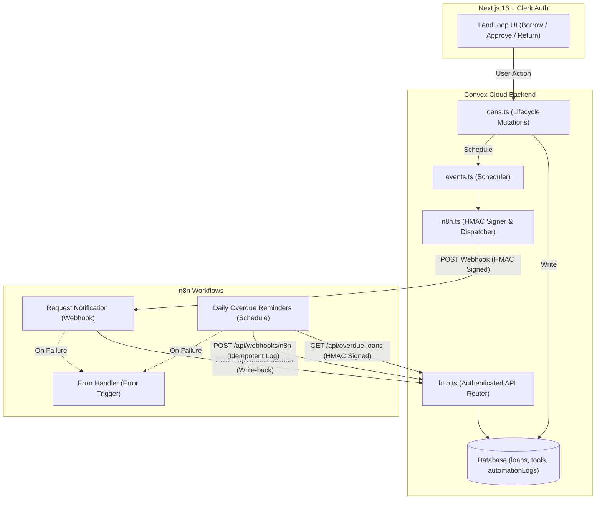

# LendLoop 🛠️

> *Borrow what you need. Lend what you don't.*

**LendLoop** is a neighborhood tool-lending board with automated workflows. Neighbors can list household tools, submit borrow requests with date ranges, manage active loans, and receive automated notifications and overdue reminders powered by **n8n**.

---

## Tech Stack

- **Frontend**: [Next.js 16](https://nextjs.org) (App Router, Turbopack, Partial Prerendering) + [Tailwind CSS v4](https://tailwindcss.com)
- **Authentication**: [Clerk Core 3](https://clerk.com) (`@clerk/nextjs` v7)
- **Backend & Database**: [Convex Cloud](https://convex.dev) (`convex ^1.49.0`)
- **Automation**: [n8n](https://n8n.io) (Cloud or self-hosted Docker)
- **Language**: TypeScript (strict mode)

---

## Architecture



---

## Key Features

1. **Public Board**: Privacy-first read-only tool catalog showing available tool names and categories (no owner identities).
2. **Authenticated Hub**:
   - **My Listings**: Full CRUD with instant availability toggles.
   - **All Tools**: Neighborhood-wide catalog with category filtering and pending-request indicators.
   - **My Requests**: Outgoing borrow requests with date ranges, status badges, and cancel options.
   - **Incoming Requests**: Owner dashboard to approve, decline, or mark tools returned.
3. **Role-Based Access Control (RBAC)**:
   - Backend-enforced permissions in Convex functions.
   - `admin` role with access to `/admin` to view all loans, moderate listings, grant "Trusted Lender" badges, and promote/demote user roles.
4. **n8n Automation**:
   - **Two-way HMAC-SHA256**: Cryptographically signed payloads in both directions with timestamp tolerance.
   - **Idempotency**: Retries never create duplicate notifications or activity records (`by_idempotency_key` index).
   - **Error Workflow & Retries**: 3 retries with backoff + dedicated error handler.
   - **In-App Activity Feed**: Live automation logs displayed on each loan card.

---

## Quickstart

### 1. Install Dependencies
```bash
npm install
```

### 2. Environment Variables
Copy `.env.example` to `.env.local`:
```bash
cp .env.example .env.local
```
Fill in your Clerk publishable/secret keys and Convex deployment URLs.

### 3. Run Development Server & Convex
```bash
# Terminal 1: Next.js dev server
npm run dev

# Terminal 2: Convex backend sync
npx convex dev
```
Open [http://localhost:3000](http://localhost:3000) in your browser.

---

## Automation Setup (n8n)

See [`n8n/README.md`](./n8n/README.md) for full details on importing the workflows, configuring environment variables, and Docker self-hosting.
