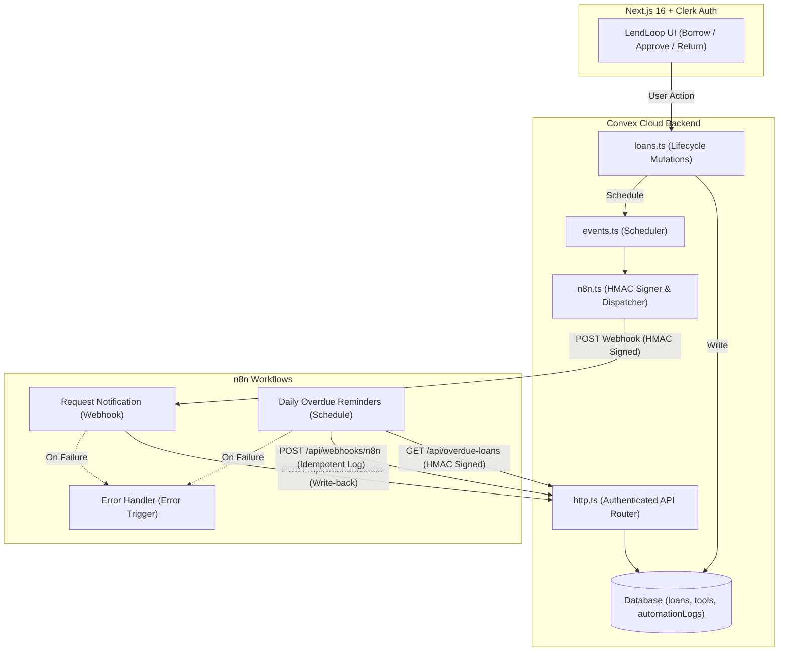

# LendLoop 🛠️

> *Borrow what you need. Lend what you don't.*

**LendLoop** is a neighborhood tool-lending board with automated workflows. Neighbors can list household tools, submit borrow requests with date ranges, manage active loans, and receive automated notifications and overdue reminders powered by **n8n**.

---

## Tech Stack

- **Frontend**: [Next.js 16](https://nextjs.org) (App Router, Turbopack, Partial Prerendering) + [Tailwind CSS v4](https://tailwindcss.com)
- **Authentication**: [Clerk Core 3](https://clerk.com) (`@clerk/nextjs` v7)
- **Backend & Database**: [Convex Cloud](https://convex.dev) (`convex ^1.49.0`)
- **Automation**: [n8n](https://n8n.io) (Cloud or self-hosted Docker)
- **Language**: TypeScript (strict mode)

---

## Architecture



---

## Key Features

1. **Public Board**: Privacy-first read-only tool catalog showing available tool names and categories (no owner identities).
2. **Authenticated Hub**:
   - **My Listings**: Full CRUD with instant availability toggles.
   - **All Tools**: Neighborhood-wide catalog with category filtering and pending-request indicators.
   - **My Requests**: Outgoing borrow requests with date ranges, status badges, and cancel options.
   - **Incoming Requests**: Owner dashboard to approve, decline, or mark tools returned.
3. **Role-Based Access Control (RBAC)**:
   - Backend-enforced permissions in Convex functions.
   - `admin` role with access to `/admin` to view all loans, moderate listings, grant "Trusted Lender" badges, and promote/demote user roles.
4. **n8n Automation**:
   - **Two-way HMAC-SHA256**: Cryptographically signed payloads in both directions with timestamp tolerance.
   - **Idempotency**: Retries never create duplicate notifications or activity records (`by_idempotency_key` index).
   - **Error Workflow & Retries**: 3 retries with backoff + dedicated error handler.
   - **In-App Activity Feed**: Live automation logs displayed on each loan card.

---

## Quickstart

### 1. Install Dependencies
```bash
npm install
```

### 2. Configure Environment Variables

Copy `.env.example` to `.env.local`:

```bash
cp .env.example .env.local
```

Configure variables across three places:

| Variable | Where Used | Purpose |
| :--- | :--- | :--- |
| `NEXT_PUBLIC_CONVEX_URL` | `.env.local` (Next.js) | Convex Cloud deployment URL |
| `NEXT_PUBLIC_CONVEX_SITE_URL` | `.env.local` (Next.js) | Convex HTTP actions base URL (`.convex.site`) |
| `NEXT_PUBLIC_CLERK_PUBLISHABLE_KEY` | `.env.local` (Next.js) | Clerk client key |
| `CLERK_SECRET_KEY` | `.env.local` (Next.js) | Clerk server key for `proxy.ts` route protection |
| `CLERK_JWT_ISSUER_DOMAIN` | Convex Env (`npx convex env set`) | Clerk JWT template (`"convex"`) issuer URL |
| `INITIAL_ADMIN_EMAILS` | Convex Env *(optional)* | Comma-separated emails auto-assigned `admin` on first sign-in (also granted to the first registered user) |
| `N8N_REQUEST_WEBHOOK_URL` | Convex Env | Inbound n8n webhook URL for `dispatchLoanEvent` |
| `N8N_WEBHOOK_SECRET` | Convex Env & n8n Docker Env | Shared 32-byte hex HMAC-SHA256 secret |
| `CONVEX_SITE_URL` | n8n Docker Env | Convex `.convex.site` URL used for `/api/overdue-loans` and `/api/webhooks/n8n` write-backs |

In Clerk Dashboard, create a JWT Template named **`convex`** so `convex/auth.config.ts` can verify session tokens. Set Convex backend variables with:

```bash
npx convex env set CLERK_JWT_ISSUER_DOMAIN "https://your-clerk-domain.clerk.accounts.dev"
npx convex env set N8N_WEBHOOK_SECRET "<your-32-byte-hex-secret>"
npx convex env set N8N_REQUEST_WEBHOOK_URL "<your-n8n-webhook-url>"
```

### 3. Run Next.js & Convex

```bash
# Terminal 1: Next.js dev server
npm run dev

# Terminal 2: Convex schema & functions sync
npx convex dev
```

Open [http://localhost:3000](http://localhost:3000).

---

## Local n8n Setup (Docker Compose)

Self-hosted n8n configuration and exported workflows live under `n8n/` (`docker-compose.yml` and `workflows/*.json`). See [`n8n/README.md`](./n8n/README.md) for the automation topology.

1. **Start n8n via Docker Compose** (from the `n8n/` directory):

   ```bash
   cd n8n
   export N8N_WEBHOOK_SECRET="<same-secret-as-convex>"
   export CONVEX_SITE_URL="https://<your-deployment>.convex.site"
   docker compose up -d
   ```

   Open the n8n editor at [http://localhost:5678](http://localhost:5678). Because `docker-compose.yml` injects `N8N_WEBHOOK_SECRET` and `CONVEX_SITE_URL` from container environment variables (never hardcoded into workflow JSONs), all exported workflows read them dynamically via `$env` / `$vars`.

2. **Import the Three Exported Workflows** from `n8n/workflows/`:
   * `error-handler.json`: Catches workflow execution errors via `Error Trigger` and formats alert logs.
   * `request-notification.json`: Receives HMAC-signed borrow lifecycle webhooks (`POST /webhook/lendloop-request-events`), validates `X-LendLoop-Signature`, logs notification output, and writes delivery status back to Convex (`POST /api/webhooks/n8n`).
   * `overdue-reminders.json`: Runs daily at 09:00 AM UTC, calls `GET /api/overdue-loans` with an HMAC signature, builds borrower reminders, and posts idempotent write-backs to Convex.

3. **Activate & Wire Up:**
   * Activate all three workflows in n8n.
   * In the **Workflow Settings** of both `request-notification` and `overdue-reminders`, set **Error Workflow** to `LendLoop — Error Handler`.
   * Point Convex's `N8N_REQUEST_WEBHOOK_URL` to your active webhook endpoint (if running Convex Cloud with local Docker n8n, expose port `5678` through a tunnel such as `ngrok http 5678` or `cloudflared` and set `N8N_REQUEST_WEBHOOK_URL` to the tunneled HTTPS URL).

---

## Security & Data-Minimization Decisions

* **Public Field Projection:** `tools.listPublic` in `convex/tools.ts` queries only `isAvailable === true` records and maps strictly to `{ _id, name, category }`. Owner identity, descriptions, conditions, and contact data stay off the unauthenticated response.
* **Server-Enforced RBAC:** Route protection in `proxy.ts` (`clerkMiddleware`) gates private routes, while `convex/lib/auth.ts` (`requireUser`, `requireAdmin`, `assertOwnerOrAdmin`) re-verifies identity and role inside every Convex query and mutation. `users.syncUser` reads identity fields directly from the verified Clerk JWT (`ctx.auth.getUserIdentity()`) instead of client arguments, and `users.setUserRole` blocks removing the last admin.
* **Bidirectional HMAC-SHA256 & Replay Window:** `convex/lib/hmac.ts` signs outbound webhook payloads and verifies inbound n8n requests using `X-LendLoop-Signature: t=<timestamp>,v1=<hex>` over `${timestamp}.${rawBody}`. Both Convex (`timingSafeEqual`) and n8n (`crypto.timingSafeEqual`) verify signatures with constant-time comparisons and reject timestamps older than 5 minutes.
* **Payload Minimization to n8n:** `dispatchLoanEvent` and `getOverdueLoans` in `convex/n8n.ts` send only the minimum fields needed to compose and log a message (`tool.name`, loan window dates, `recipient.name`, `recipient.email`, `actor.name`), excluding full user profiles, roles, and unrelated database records. Secrets live strictly in Convex env vars and Docker env vars (`N8N_BLOCK_ENV_ACCESS_IN_NODE=false`, `NODE_FUNCTION_ALLOW_BUILTIN=crypto`), never in exported JSON files.
* **Idempotent Write-Backs & Visible Retries:** `automationLogs` indexes entries by `by_idempotency_key` (`convex/schema.ts`). Repeated deliveries of the same request event or daily reminder key (`overdue_reminder:<loanId>:<YYYY-MM-DD>`) exit early in `recordAutomationLog` without creating duplicate activity rows or incrementing `reminderCount`. Outbound webhook dispatches retry transient errors up to 3 attempts with backoff (`500ms`, `1500ms`) and log final failures to `automationLogs`.

---

## Production Readiness (What I Would Change for Production)

* **Real Notification Transport:** Replace the mock delivery Code nodes in `request-notification.json` and `overdue-reminders.json` with a transactional provider (such as Resend/Postmark with DKIM/SPF or Slack incoming webhooks) and store per-user notification opt-in preferences before emailing.
* **Terraform & Managed Hosting for n8n:** Rather than running n8n against a single container volume (SQLite), either use n8n Cloud or manage self-hosted n8n on AWS with **Terraform** (ECS/Fargate behind an ALB with TLS, private VPC subnets, **RDS PostgreSQL** for execution state, and AWS Secrets Manager for `N8N_WEBHOOK_SECRET`), while keeping Next.js, Clerk, and Convex on managed tiers.
* **CI/CD Pipeline & Automated Tests:** Add GitHub Actions workflows that run `tsc --noEmit`, ESLint, and `convex-test` integration suites (covering RBAC boundaries, booking overlap prevention, and HMAC replay/tamper checks) on pull requests, then deploy Next.js and promote schema/functions across `staging` and `production` via `npx convex deploy` on merges to `main` alongside n8n workflow sync.
* **Alerting & Observability:** Connect `error-handler.json` to an active pager channel (Slack/PagerDuty/email) and forward Convex/Next.js errors and webhook latency metrics to Sentry or Datadog, keeping PII out of error log payloads.
* **Pagination on Overdue Polling:** Update `getOverdueLoans` (currently `.take(100)`) to support cursor-based pagination in `GET /api/overdue-loans` so larger neighborhoods process all overdue loans without truncation.
* **Secret Rotation & Rate Limiting:** Rotate `N8N_WEBHOOK_SECRET` with dual-key verification (`v1`/`v2` headers) backed by AWS Secrets Manager or KMS, and add per-IP / per-key rate limiting in front of `/api/*` HTTP endpoints.
