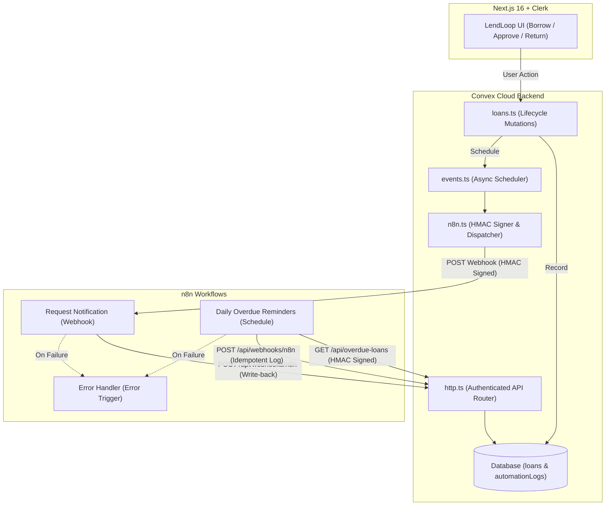

# LendLoop Automation (n8n)

## Architecture



---

## File Structure

```
n8n/
├── README.md
├── docker-compose.yml
└── workflows/
    ├── error-handler.json        # Error trigger catching workflow failures
    ├── overdue-reminders.json     # 9:00 AM daily cron polling overdue loans
    └── request-notification.json  # Real-time webhook for borrow status events
```

---

## Environment Variables

```bash
# Convex Deployment
npx convex env set N8N_WEBHOOK_SECRET "your_hmac_secret"
npx convex env set N8N_REQUEST_WEBHOOK_URL "https://your-instance.app.n8n.cloud/webhook/lendloop-request-events"

# n8n Cloud (Personal -> Variables)
# N8N_WEBHOOK_SECRET = your_hmac_secret
# CONVEX_SITE_URL    = https://your-deployment.convex.site
```
